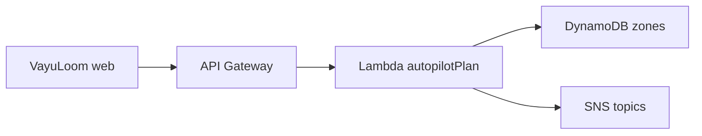
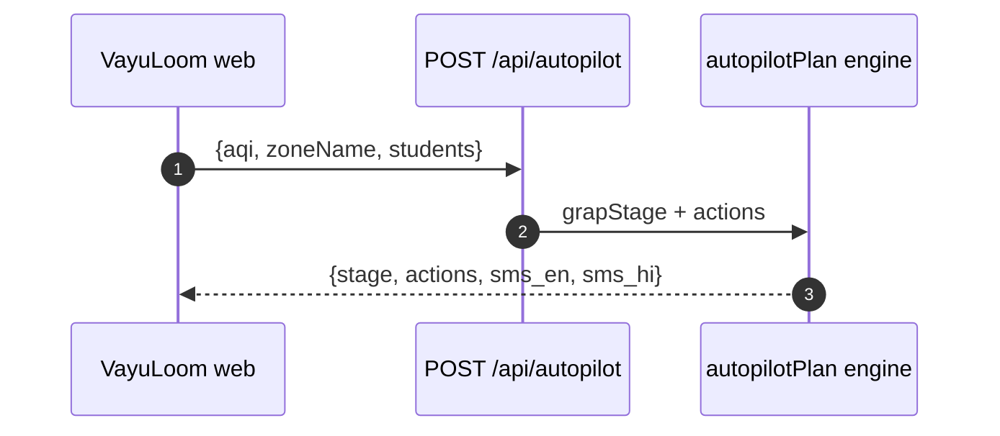
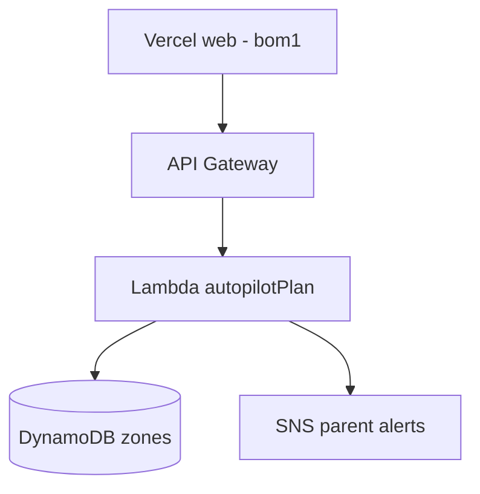

# VayuLoom — Air Safety OS for Indian schools


[](https://github.com/aniruddhaadak/vayuloom/actions/workflows/ci.yml)
[](LICENSE)
[](docs/adr/ADR-002-deterministic-sim.md)

## What is VayuLoom?

VayuLoom tracks air quality across 12 Delhi school zones and turns AQI
readings into GRAP-stage advisories with parent SMS text in English and Hindi.
Every number is deterministic (seed `7331`), so demos, tests, and CI always
agree.

## What you can do

| # | Capability | Where |
|---|-----------|-------|
| 1 | View 12-zone AQI observatory | `/observatory` |
| 2 | Check a school exposure card | `/school/[id]` |
| 3 | Get a GRAP autopilot plan | `POST /api/autopilot` |
| 4 | Fetch deterministic zone AQI | `GET /api/aqi` |
| 5 | Ping service health | `GET /api/health`, `/healthz` |
| 6 | Run the Python agents service | `services/agents` |
| 7 | Copy bilingual parent SMS | autopilot response `sms_en`, `sms_hi` |
| 8 | Deploy web + agents with Docker | `docker compose up` |

## Quickstart

```bash
bun install
bun dev            # http://localhost:3000
bunx vitest run    # API + engine tests
bun run build
```

Docker (web + agents):

```bash
docker compose up --build
# web  -> http://localhost:3000/api/health
# agent -> http://localhost:8001/health
```

Python service alone:

```bash
cd services/agents
pip install -r requirements.txt
uvicorn app:app --port 8001
pytest test_app.py -v
```

## How it works

1. **Observe** — `GET /api/aqi` returns 12 Delhi zones with deterministic AQI
   values derived from seed `7331`.
2. **Decide** — `POST /api/autopilot` maps `{aqi, zoneName, students}` to a
   GRAP stage (None, I–IV) with a fixed action list.
3. **Notify** — the response includes ready-to-send `sms_en` and `sms_hi`
   parent alerts.
4. **Mirror** — `services/agents` (FastAPI) runs the same logic in Python for
   the agent layer, with OpenAPI docs at `/docs`.
5. **Ship** — the Next.js app deploys to Vercel while the engine runs on AWS
   Lambda + API Gateway (see mapping below).

## Architecture







Full diagrams: [`docs/diagrams/`](docs/diagrams/) (12 files: architecture,
request-flow, domain-model, agent-lifecycle, cicd, user-journey, mindmap,
branching, roadmap, classes, quadrant, infra).

## AWS mapping

| Build It (prototype) | Ship It (production) |
|----------------------|----------------------|
| Strands SDK agent | Lambda `autopilotPlan` |
| Cedar policies | Lambda authorizer + Cedar |
| OpenSearch AQI index | OpenSearch Serverless |
| SAM + LocalStack | API Gateway + Lambda deploy |
| Finch containers | ECR + Lambda container images |
| — | DynamoDB zones table |
| — | S3 snapshots bucket |
| — | CloudFront distribution |
| — | SNS parent-alert topics |

Free Tier note: Lambda (1M requests/mo), DynamoDB (25 GB), S3 (5 GB), SNS
publishes, and CloudFront egress each fit the AWS Free Tier for a
school-pilot slice; OpenSearch Serverless is the first service to budget for.

## Scale note

Seed `7331` drives every synthetic value. This repo is an honest hackathon
slice: 12 zones, deterministic sim, in-memory thresholds. The scale engine
(post-event) adds live CPCB ingest, per-school state in DynamoDB, and the
Strands agent fleet — tracked in [`docs/diagrams/roadmap.mmd`](docs/diagrams/roadmap.mmd).

## Docs map

- Diagrams: `docs/diagrams/*.mmd`
- Decisions: `docs/adr/ADR-001` … `ADR-005`
- Agents service: `services/agents/README.md`
- Contributing: `CONTRIBUTING.md` · Conduct: `CODE_OF_CONDUCT.md`
- Security: `SECURITY.md` · Support: `SUPPORT.md`

## Contributing

Small, focused PRs against `main`. Run `bunx tsc --noEmit` and
`bunx vitest run` before pushing. See [CONTRIBUTING.md](CONTRIBUTING.md) and
the [PR template](PULL_REQUEST_TEMPLATE.md).

## License

MIT © 2026 Aniruddha Adak — see [LICENSE](LICENSE).
